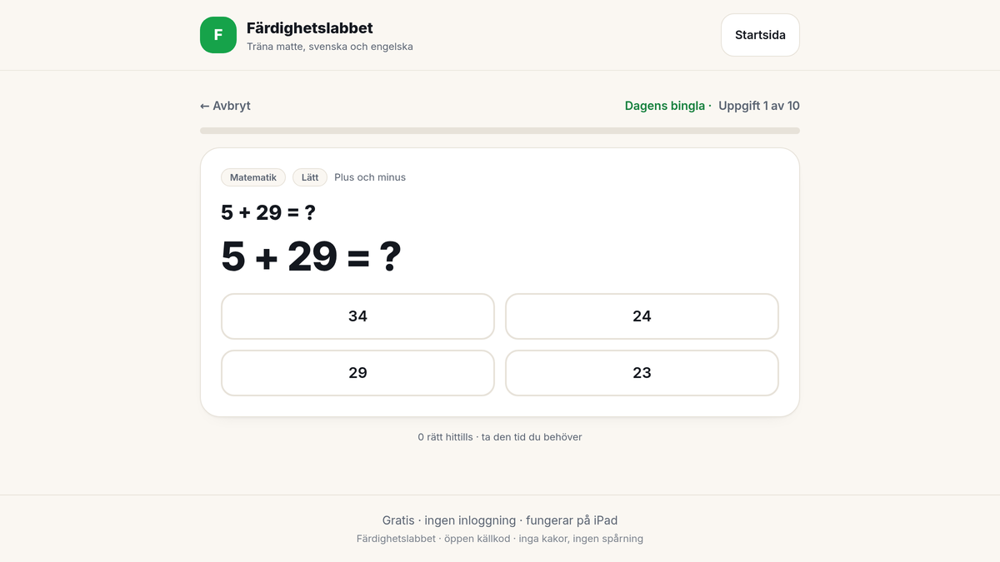

# Färdighetslabbet

Gratis färdighetsträning för åk 4–6 i **matematik**, **svenska** och **engelska**. Tio uppgifter per pass, direkt
återkoppling och en nivå som anpassar sig efter resultatet. Ingen inloggning, inga kakor och inga anrop till externa
servrar.

**Spela:** https://fardighetslabbet.skolappar.org · En del av [Skolappar](https://www.skolappar.org) – pedagogiska appar av föräldrar · öppen källkod (MIT)



## Vad du kan göra

- **Tre ämnen, tre nivåer** (lätt, medel, svår).
  - Matematik: addition/subtraktion, multiplikation/division, bråk och procent – alla uppgifter genereras av koden och
    svaren räknas ut, så de tar aldrig slut.
  - Svenska: stavning (välj rätt av två alternativ), ordklasser och synonymer (para ihop ord).
  - Engelska: glosor svenska → engelska, glosor engelska → svenska och prepositioner i fraser.
- **Pass om 10 uppgifter** med blandade uppgiftstyper, direkt återkoppling med rätt svar och en kort förklaring.
- **Adaptiv nivå**: 8–10 rätt höjer nivån till nästa pass, 6–7 rätt behåller nivån, 0–5 rätt sänker den.
- **Stjärnor 0–3 per pass** (9–10 rätt = 3, 7–8 = 2, 5–6 = 1).
- **Dagens bingla**: en daglig omgång om tio blandade uppgifter per ämne. Uppgifterna är desamma hela dygnet och byts
  ut vid midnatt. Klart-status och stjärna sparas per datum.
- **Översikt för lärare/förälder**: antal pass, klara binglor, nivå och bästa resultat per ämne samt ett enkelt
  stapeldiagram över de tio senaste passen (rätt/fel).
- **Touchvänligt**: svarsknappar på minst 52 px, inga hover-beroenden, inga timers och ingen tidspress.

Allt sparas lokalt i webbläsaren under nyckeln `fardighetslabbet-v1`. Inget skickas någonstans.

## Kom igång

```bash
npm install
npm run dev      # utvecklingsserver
npm run build    # produktionsbygge i dist/
npm run preview  # förhandsgranska bygget
npm run verify   # innehålls- och svarskontroll (node)
npm run typecheck
```

Dockerfilen bygger med Node 22.

## Docker

```bash
docker build -t fardighetslabbet .
docker run --rm -p 8080:8080 fardighetslabbet
```

Bygget serveras av nginx på port 8080 med `deploy/nginx.conf`.

## Innehåll

Ordlistorna ligger i `src/lib/content.ts` och är skrivna för den här appen: 70 stavningspar, 60 synonympar, 188
engelska ordpar, 26 prepositionfraser och 97 ord för ordklasser. Matematiken genereras i `src/lib/math.ts` med
räknestyperna `add`, `sub`, `mul`, `div`, `missing`, `frac` och `percent`. Varje uppgift bär sina tal, så
`npm run verify` kan räkna om svaret oberoende av generatorn.

## Struktur

```
src/App.tsx            vyer: start, dagens bingla, ämne, pass, resultat, översikt
src/lib/types.ts       typer för ämnen, nivåer och uppgifter
src/lib/content.ts     stavning, ordklasser, synonymer, engelska ordpar, prepositioner
src/lib/math.ts        slumptal, räknestyper, generatorer och svarsalternativ
src/lib/tasks.ts       bygger pass och dagens bingla
src/lib/progress.ts    stjärnor, nivåbyte, historik och localStorage
scripts/verify-content.ts  kontroll av innehåll, svar och sparning
```

## Integritet

Appen har inga nätverksanrop i drift, sätter inga kakor och kräver inget konto. Typsnittet Fredoka ligger i appen (`public/fonts/`). Inga typsnitt hämtas utifrån. Framstegen kan nollställas från startsidan.

## Licens

MIT – se [LICENSE](LICENSE).
